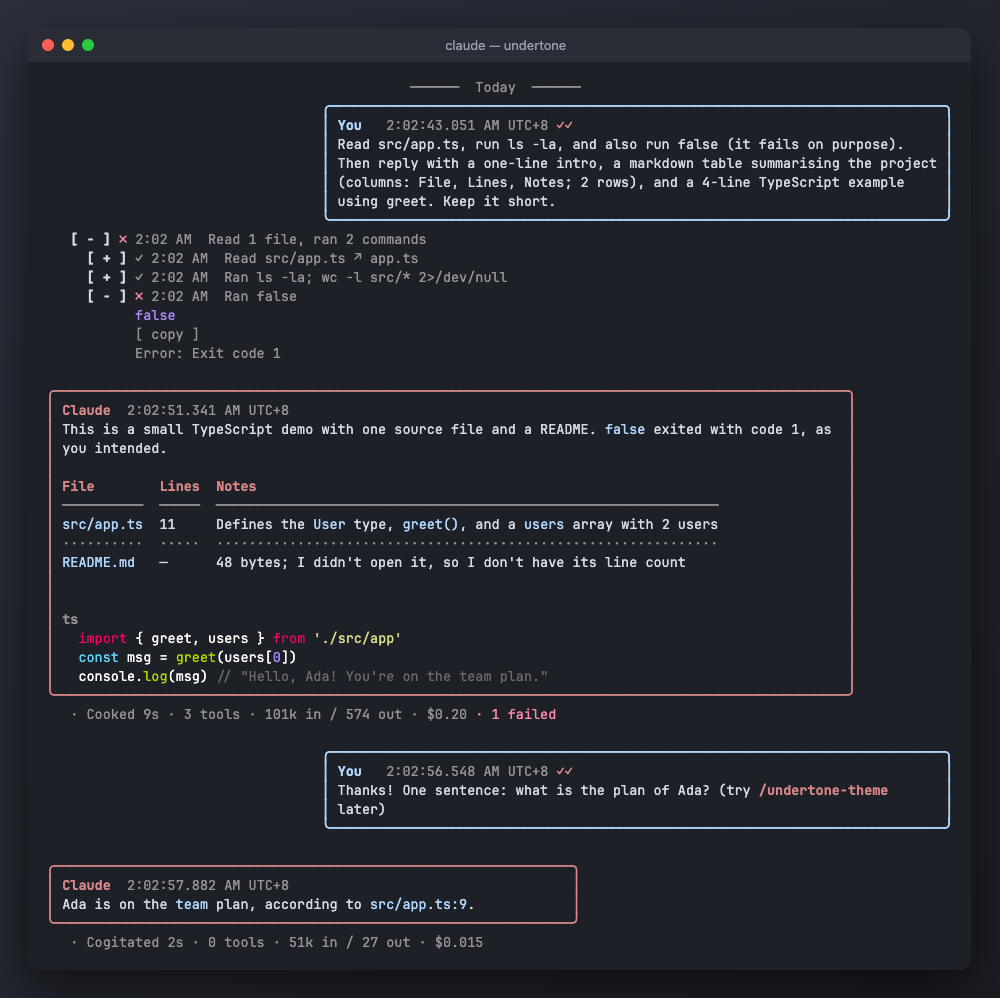
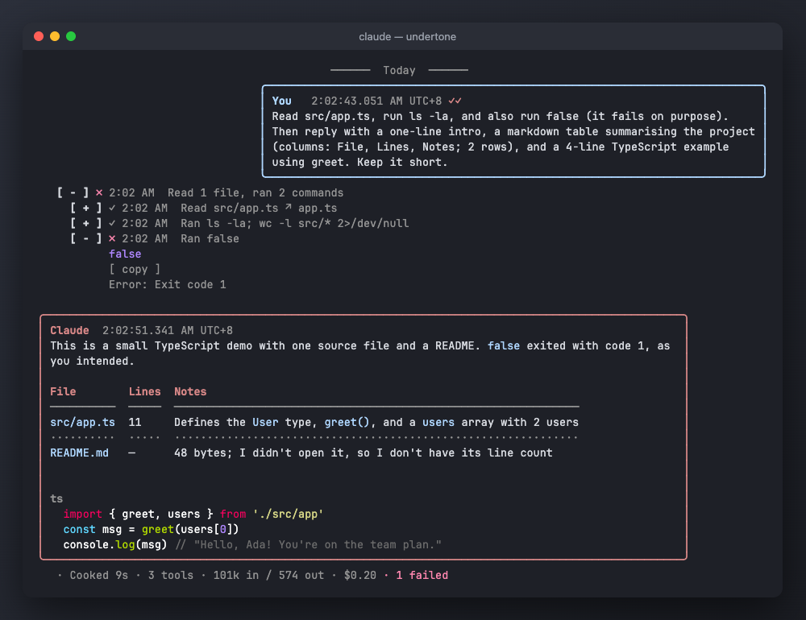
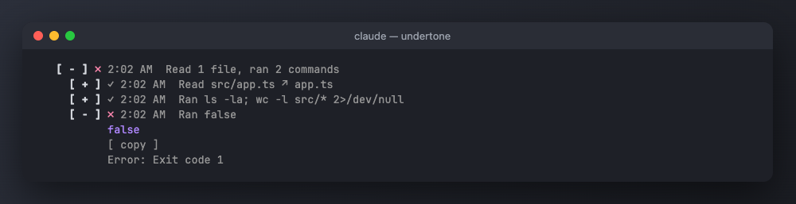
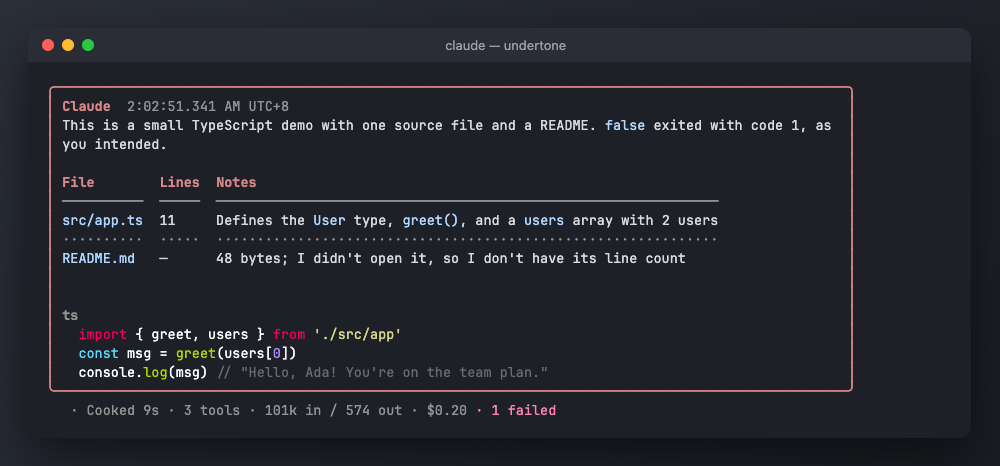
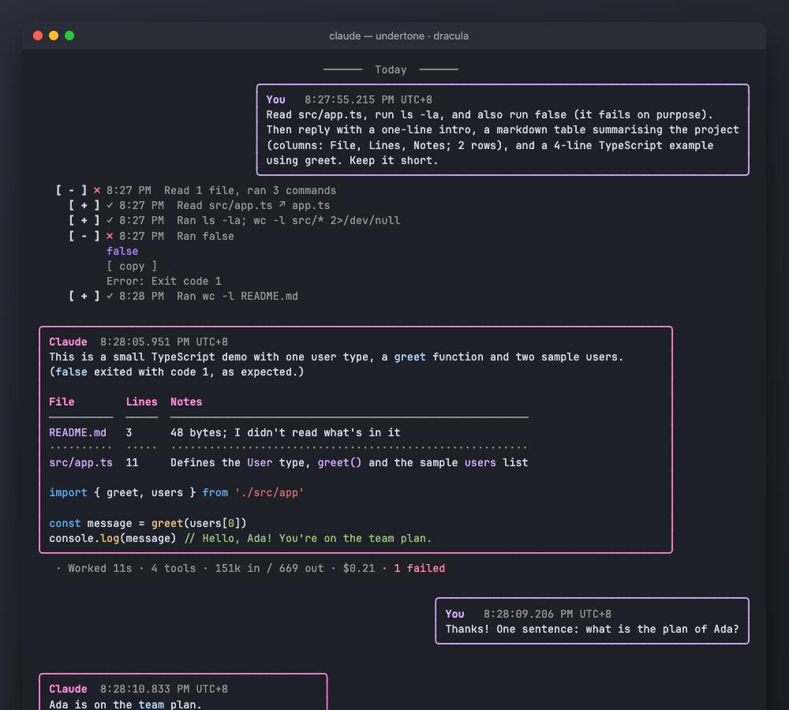
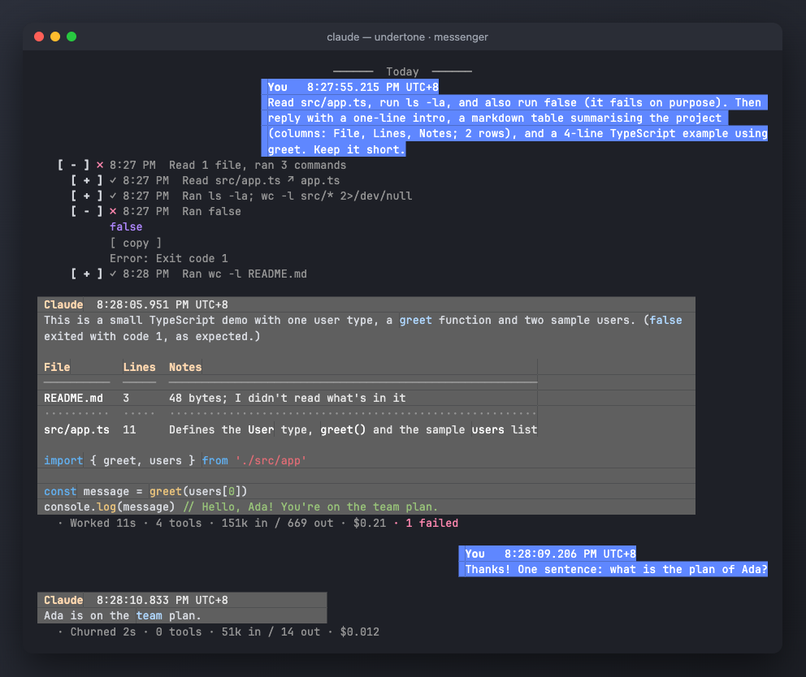
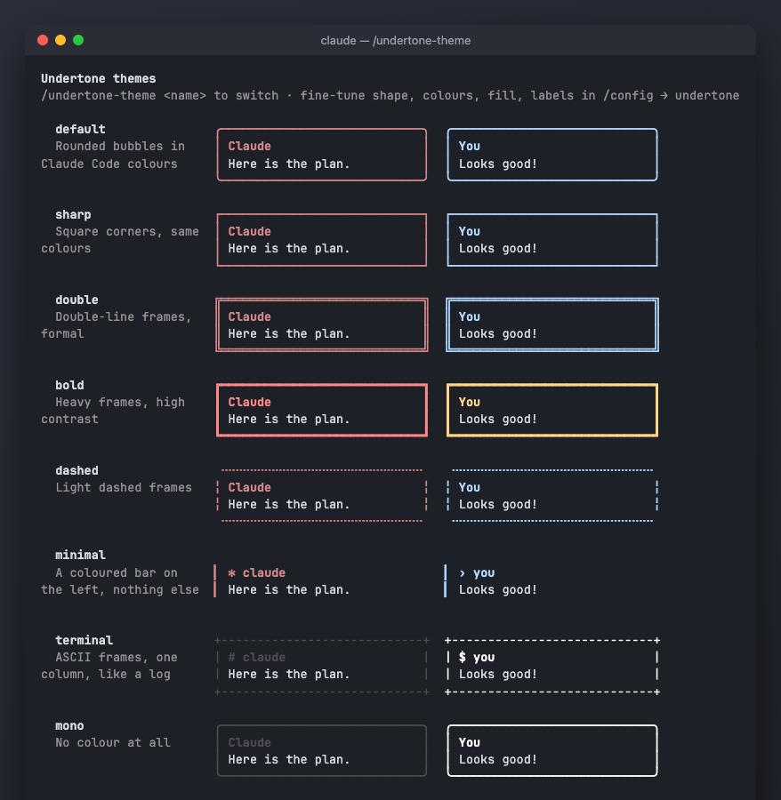

<p align="center"></p>

<h1 align="center">undertone</h1>

<p align="center"><strong>The conversation, without the noise.</strong></p>

<p align="center">
  A Claude Code mod that turns the transcript into a chat you can actually read:<br>
  your messages and Claude's in bubbles, every tool call folded into a quiet one-line undertone.
</p>

<p align="center">
  <a href="#install">Install</a> ·
  <a href="#what-you-get">Features</a> ·
  <a href="#themes">Themes</a> ·
  <a href="#commands">Commands</a> ·
  <a href="#settings">Settings</a> ·
  <a href="#develop">Develop</a>
</p>



---

## Why

Most of a Claude Code session is tool calls: reads, greps, shell commands, edits. They matter when something
goes wrong, and they're noise the other 80% of the time. Meanwhile the two things you actually came for, what you
asked and what Claude answered, get lost between them.

undertone flips that around:

- **The conversation is the signal.** Your prompts sit on the right, Claude's replies on the left, each in its own bubble with a timestamp.
- **Tool calls are the undertone.** Each call is one dim line in plain words (`Ran gh pr view 12`, `Read src/app.ts`), and a run of calls folds into one (`Ran 3 commands, read 2 files`). Nothing is hidden: one click opens any of them, with the code highlighted.
- **Failures still shout.** A failed call opens by itself and the turn's summary line counts it in red.

## Install

```
/plugin marketplace add jofftiquez/undertone
/plugin install undertone@undertone
```

Then try `/undertone setup` to pick a theme and layout with a live preview. `/undertone off` gives you Claude Code's own look back for the session; `/undertone on` brings undertone back.

Works on **macOS, Linux and Windows**. Requires a Claude Code build with mod support.

## What you get

### Bubbles and time



- **Chat bubbles**: yours right-aligned, Claude's left, sized to the text, capped at a share of the width you choose.
- **Timestamps in your local time**, down to the millisecond with the timezone (`7:32:27.946 PM UTC+8`), or short (`7:32 PM`). Times come from Claude Code's own transcript, so they're right for older messages and resumed sessions too.
- **Day and pause dividers**: `── Today ──`, `── Yesterday ──`, `── 2h 10m later ──`.
- **Long replies fold** behind `[ more · 23 lines ]`; **old turns fold** behind `── 42 earlier turns [ show ] ──`.

### Tool calls, quietly



- One line per call, in plain words, with a status mark: `◌` running, `✓` done, `✗` failed (opens by itself), `⊘` interrupted.
- `[ + ]` opens a call with its **highlighted** command, diff, file or output, and a `[ copy ]` button.
- Grouped calls fold into one summary row.
- File paths open a **side panel** with the file, highlighted, and an *Open in editor* button that always opens a text editor.
- A **turn summary** after each reply: `· Baked 42s · 5 tools · 38k in / 1.2k out · $0.041 · 1 failed`.
- While Claude works, the spinner counts tools live: `Sauteing · 3 tools…`

### Tables that fit



Claude Code lays tables out for the full terminal width, so inside anything narrower they break. undertone draws
tables itself, fitted to the bubble: columns keep their natural width when everything fits, otherwise long cells wrap
inside their column. Wide characters (CJK, emoji, `★`) are measured as two cells, alignment (`:---:`, `---:`) is
honoured, and **bold**, `code` and links keep their style. Styles: `rules`, `box` or `minimal`.

Two ways to copy a table: `[ copy table ]` gives you the Markdown (for GitHub, Notion, Obsidian), and
`[ copy as cells ]` gives you tab-separated plain text, which Slack, Excel, Google Sheets and Numbers paste as a real
table.

### Rich text

Claude's replies draw block by block, in the theme's colours:

- **Headings**: H1 in a box, H2 over a heavy rule, H3 bold in an accent colour. *Heading style*: `banner`, `bold` or `underline`.
- **Lists** keep their numbers and nest with `•` `◦` `▪`; **task lists** draw as `[ ]` and `[✓]`, done items dimmed and struck through. *Task list style*: `brackets`, `ticks` (`○` `✓`), `box` (`□` `✓`) or `progress`, which adds a done-count bar.
- **Quotes** get an accent bar; **GitHub alerts** (`> [!NOTE]`, `[!TIP]`, `[!IMPORTANT]`, `[!WARNING]`, `[!CAUTION]`) draw as coloured boxes with their label.
- **Code** sits under a header with its language and `[ copy code ]`, highlighted, with no frame, so a mouse selection copies just the code.
- **Rules** draw across the bubble; lists and quotes get `[ copy list ]` and `[ copy quote ]`.
- Inline text (bold, italic, code, links) is Claude Code's own, so links stay clickable. *Rich text* off gives Claude Code's drawing back.

### Pictures

When a picture explains better than prose, Claude can draw one, and undertone draws it in the bubble:

- **Charts** from ` ```mermaid ` blocks: `xychart-beta` bar and line series as bars measured to an eighth of a cell, the tallest one highlighted, and `pie` charts as share bars, largest first.
- **Flowcharts** (`graph LR` / `TD`): a straight chain as boxes joined by arrows, with edge labels; branches and loops as a tree, `↺` where it loops back.
- **Figures**: a ` ```figure ` block draws exactly as written, with `{accent:…}`, `{warn:…}`, `{ok:…}`, `{note:…}`, `{dim:…}` and `{strong:…}` colouring a run. A line that would not draw as written (too wide, a tab, broken markup) leaves it as code, with a note saying why.
- `[ copy source ]` and `[ copy art ]` on each. Other mermaid kinds, and a block still streaming, stay code.
- So Claude knows, each prompt you type carries a short note only the model reads (about 130 tokens); *Tell Claude about pictures* turns it off.

### Math, footnotes and copying

- **Math**: inline `$E = mc^2$` reads *E = mc²*, and `$\alpha \le \beta$` reads *α ≤ β* (a price like `$5` stays as written). Display math, `$$…$$` or a ` ```math ` block, reads as text with symbols, `(-b ± √(b²-4ac))/2a`, or as a typeset picture where the terminal draws pictures and [`ratex-render`](https://github.com/erweixin/RaTeX/releases) is on your `PATH` (rename the release's `render` binary). `[ copy latex ]` copies the source.
- **Footnotes**: `[^1]` marks draw as superscripts, `¹`, with the notes under a short rule at the end of the reply.
- **Copy without the mouse**: `/undertone copy` copies the last reply, `/undertone copy code` its last code block.
- **Tables** also get `[ copy art ]`: the drawn, boxed table, for pasting where Markdown doesn't render.

### Like a chat app

- **Reactions**: `[ react ]` on any bubble, then 👍 💖 😂 🤯. They show under the bubble, survive restarts and go into exports; press one again to take it back.
- **Quote-reply**: select part of Claude's reply and press `[ reply ]`; your prompt starts with it as a `> quote`. With nothing selected, it quotes the reply's first lines.
- **Read receipts**: your latest prompt shows `✓` until Claude starts on it, then `✓✓`.
- **Quick replies**: after Claude answers, `[ Go ahead ] [ Explain more ] [ Shorter, please ]` sit above the prompt; one press sends it as you. Set your own in `/config` (separated by `|`), or `off`.
- **Light by day, dark by night**: for themes with both versions (messenger, catppuccin, gruvbox, solarized, github, rose-pine), turn on *Light by day, dark by night* and set the hours (default `7-19`).

### The room

- **System cards**: every slash command's output in a card: the command in Claude's colour, `[ copy ]` and the time; a red frame and `✗` when it failed.
- **Group chat**: a message from an agent, teammate or another session is its own bubble with its name and colour; a finished background task is a chip, `✓ Explore finished · 9s`.
- **Agents**: Claude handing work to an agent reads `↳ Claude → Explore: find the config`, with `◌ working` or `↗ in background`, then `✓ done`; a foreground agent's report is its own bubble, folded when long, and a background agent's arrives as its own message. Above the prompt, `Agents ● Explore · find the config ○ planner (done)`, and the turn summary counts them apart: `· 5 tools · 2 agents (31 tools)`.
- **Claude asks**: Claude's multiple-choice questions sit under a `Claude asks` header, and the call's row says what was asked.
- **Welcome**: `✻ Good morning · 3rd session today · last one ended 2h ago` when a session starts (with your name, if you set *Your label*).
- **Footer pills** for mode labels, and a quieter run-in-background hint: `↧ ctrl+b · background` (or hidden).

### Show-off

- **Pictures inline**: a pasted PNG screenshot shows as a picture in your bubble, and a PNG Claude reads shows under its row, sized to its shape. Needs a terminal that draws pictures (kitty, Ghostty, iTerm2 3.5+); elsewhere you get the chip.
- **✨ all green**: when a turn's last test run passed (`12 passed`, `test result: ok.`, Go's `ok`), its summary line says so.
- **`/undertone-wrapped`**: a recap of the session: prompts, tool calls, top tools, busiest hour, longest turn, all-green turns, reactions, cost.
- **`/undertone-find <words>`**: the messages that contain the words, with their times and the words in context.
- **Wallpaper** (Claude desktop app only): a background in the theme's colours, if you turn it on.

### Small things that add up

- **Slash commands stand out**: a command you mention in a prompt (`try /undertone-theme`) is drawn bold in Claude's colour. Only real commands count, so paths like `/tmp/x` stay plain. (A command you run on its own is drawn by Claude Code, not as a bubble.)
- **Copy buttons** on every reply, code block, quote and table; in fullscreen they appear only when you point at the bubble. They use Claude Code's own clipboard, so they work over SSH too.
- **Pins**: `☆` on any bubble, then `/undertone-pins` lists what you pinned, with times. Pins survive restarts.
- **Export**: `/undertone-export` writes the conversation to Markdown with every timestamp.
- **Pasted images** become chips (`🖼 Image #3`) that open in your image viewer.
- **A notification** when a long turn finishes (macOS Notification Center, `notify-send`, Windows toast), so you can look away.
- **A context meter** under the input: `ctx 45%`, then `▲`, then `⚠ compact soon`.

## Themes

The same conversation in three of them: `default`, `dracula`, and `messenger` (filled):

<table>
  <tr>
    <td></td>
    <td></td>
    <td></td>
  </tr>
  <tr><td align="center"><code>default</code></td><td align="center"><code>dracula</code></td><td align="center"><code>messenger</code></td></tr>
</table>



**39 presets**, every one previewable with `/undertone-theme` and switchable on the spot:

| Group | Presets |
|---|---|
| Shapes, in your terminal's own colours | `default` (rounded) · `sharp` · `double` · `bold` · `dashed` · `minimal` (a left bar) · `terminal` (ASCII, one column) · `mono` |
| Filled, like a messaging app | `messenger` · `messenger-light` |
| Inspired by popular editor themes | `dracula` · `catppuccin-mocha` · `catppuccin-macchiato` · `catppuccin-latte` · `tokyo-night` · `nord` · `gruvbox` · `gruvbox-light` · `solarized-dark` · `solarized-light` · `one-dark` · `monokai` · `github-dark` · `github-light` · `rose-pine` · `rose-pine-dawn` · `everforest` · `kanagawa` · `ayu` · `night-owl` · `palenight` · `synthwave-84` · `cobalt2` · `horizon` · `material` · `tomorrow-night` |
| undertone originals | `ocean` · `forest` · `sunset` · `random` (a dark preset each load) |

Then fine-tune any part in `/config → undertone`: **bubble style** (framed or filled, for any theme), **shape** per
side (rounded, sharp, double, bold, dashed, ascii, bar, none), **colours** (border, fill, text; hex, `rgb()`,
`ansi256()` or Claude Code's colour names), **labels and icons**, **padding**, **spacing**, **alignment** and the
**divider** character. Text on filled bubbles is picked to stay readable, and a mistyped colour is ignored instead of
breaking the bubble.

## Commands

| Command | What it does |
|---|---|
| `/undertone` | Help |
| `/undertone setup` | Pick theme, bubble style, shapes, padding, spacing, alignment, buttons and time format, with a live preview |
| `/undertone off` · `/undertone on` | Claude Code's own look for this session, and back |
| `/undertone copy` · `/undertone copy code` | Copy the last reply, or its last code block |
| `/undertone-theme [name]` | Theme gallery, or switch theme; `reset` returns to the `/config` choice |
| `/undertone-pins` | Your pinned messages, in time order |
| `/undertone-export [path]` | Save the chat as Markdown with timestamps (default: `~/Downloads`) |
| `/undertone-wrapped` | A recap of this session |
| `/undertone-find <words>` | Messages that contain the words, with their times |
| `/undertone-doctor` | What the timestamp index holds, for bug reports |

## Settings

Everything is in `/config → undertone`. The ones you'll reach for first:

| Setting | Default | |
|---|---|---|
| Theme | `default` | Any preset above, or `random` |
| Bubble style | `preset` | `framed`, `filled` |
| Your / Claude's bubble shape | `preset` | `rounded`, `sharp`, `double`, `bold`, `dashed`, `ascii`, `bar`, `none` |
| Bubble buttons | `hover` | `inline` to always show ☆ and copy |
| Table style | `rules` | `box`, `minimal` |
| Time format | `precise` | `short` |
| Keep last N turns unfolded | `10` | `0` never folds |
| Fold replies longer than | `15` lines | |
| Gap divider after | `60` minutes | |
| Quick replies | `Go ahead\|Explain more\|Shorter, please` | `off` = none |
| Light by day, dark by night | off | with *Daytime hours* `7-19` |
| Welcome line | on | |
| Run-in-background hint | `compact` | `hidden`, `engine` |
| Rich text | on | off = Claude Code's own Markdown |
| Heading style | `banner` | `bold`, `underline` |
| Task list style | `brackets` | `ticks`, `box`, `progress` |
| Tell Claude about pictures | on | the note on your prompts |
| Math as pictures | on | needs `ratex-render`; off = text |
| Pictures inline | on | |
| Desktop app wallpaper | `off` | `theme` |
| System notification for long turns | on, after `30` s | |
| Enabled | on | off = Claude Code's own look |

## Privacy and side effects

- **No network.** Nothing leaves your machine.
- **Programs it runs**, each with a timeout (5 s, 15 s on Windows): your OS's image viewer when you click a pasted image, a text editor for *Open in editor* (`open -t` on macOS, Notepad on Windows, the default text editor through `gtk-launch` on Linux; never the default app, so a script or app a tool call wrote is opened, not run), the notifier for long turns, `tail`/`head` (or PowerShell) to read the session transcript in pieces, and `base64` (or PowerShell) to save pasted images.
- **Pasted images** are copied to a private folder in your temp directory (readable only by you) so they can open, and **deleted when the session ends**.
- On Windows, PowerShell runs by its full path (`%SystemRoot%\System32\…`), non-interactive, and receives its input as ASCII-escaped JSON.

## Develop

Clone the repo and point Claude Code at it; after a change, `/reload-plugins` picks it up in an open session:

```bash
git clone https://github.com/jofftiquez/undertone ~/Documents/workspace/undertone
echo 'export CLAUDE_CODE_PLUGIN_DIRS="$HOME/Documents/workspace/undertone"' >> ~/.zshrc
```

Don't also install the published copy on the same machine, or both will draw every row.

```bash
claude plugin validate .   # what the engine will load, and what it would refuse
claude plugin test .       # 257 tests: every feature, every theme in every style, tables at 4 widths
```

CI runs `validate` and `test` on every push and pull request, and weekly against the latest Claude Code. The type check needs the engine types Claude Code
writes to `.claude-plugin/types/` when it loads the mod, so run it locally: `npx -p typescript tsc --noEmit -p .`

The code lives in `hooks/register.tsx`; the state contract in `types/index.d.ts`.

## License

[MIT](LICENSE) © Joff Tiquez. Theme presets use the accent colours of the editor themes they are named after, all
of which are open source; undertone is not affiliated with any of them.
